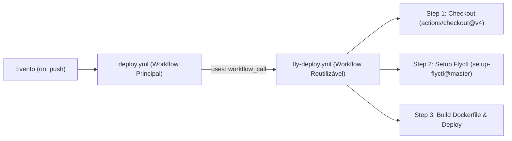

# Guia Prático de CI/CD no Front-end: Do Zero ao Deploy Automatizado com GitHub Actions, Docker e Fly.io

Este repositório é um tutorial prático e público de referência sobre como estruturar um pipeline validado de **CI/CD (Integração e Entrega Contínua)** utilizando **GitHub Actions**, **Docker (Multi-stage)**, **GitHub Secrets** e **Workflows Reutilizáveis (`workflow_call`)**, realizando o deploy de uma aplicação **Next.js** no **Fly.io**.

Todo o passo a passo abaixo foi desenhado explicando **linha por linha** cada arquivo de configuração (e com links para as documentações oficiais) para que você possa utilizar este mesmo fluxo nos seus projetos pessoais e profissionais.

---

## Sumário

1. [O que é o GitHub Actions e seus Fundamentos](#1-o-que-é-o-github-actions-e-seus-fundamentos)
2. [Configuração do `.env.example` e das Secrets no GitHub](#2-configuração-do-envexample-e-das-secrets-no-github)
3. [Configuração do `Dockerfile` (Explicação Linha a Linha)](#3-configuração-do-dockerfile-explicação-linha-a-linha)
4. [Configuração do Fly.io (`fly.toml` e Token de Acesso)](#4-configuração-do-flyio-flytoml-e-token-de-acesso)
5. [Montagem da pasta `.github/workflows`](#5-montagem-da-pasta-githubworkflows)
6. [Montando a Action: Explicação Linha a Linha dos Arquivos YAML](#6-montando-a-action-explicação-linha-a-linha-dos-arquivos-yaml)
7. [Possíveis Evoluções: Testes, PR Checks e Fly.io vs. VPS Própria](#7-possíveis-evoluções-testes-pr-checks-e-flyio-vs-vps-própria)
8. [Conclusão e Referências Oficiais](#8-conclusão-e-referências-oficiais)

---

## 1. O que é o GitHub Actions e seus Fundamentos

O **GitHub Actions** é a plataforma nativa de automação e CI/CD integrada ao próprio GitHub. Com ele, você configura fluxos automatizados que reagem a eventos do seu repositório — como validar código em um *Pull Request* ou publicar sua aplicação em produção assim que um commit entra na branch `main`.

Para ler e criar qualquer automação sem decorar sintaxe, basta dominar **5 conceitos fundamentais** (veja também nosso [GLOSSARY.md](./GLOSSARY.md)):



- **Workflow (Fluxo de Trabalho)**: O processo automatizado completo, definido por um arquivo `.yml` dentro de `.github/workflows/`.
- **Event (Evento / Gatilho — `on`)**: O que dispara o workflow (`push` na branch `main`, abertura de `pull_request`, clique manual com `workflow_dispatch` ou chamada entre workflows com `workflow_call`).
- **Runner (`runs-on`)**: A máquina virtual limpa (ex: `ubuntu-latest`) que o GitHub provisiona do zero para executar o seu trabalho.
- **Job (Trabalho)**: O agrupamento de etapas que rodam dentro do mesmo *Runner*.
- **Step (Passo) e Action (Ação)**: Cada etapa executada sequencialmente dentro de um *Job*, podendo ser um comando de terminal (`run`) ou uma **Action** pronta da comunidade (`uses`).

📚 **Referência oficial:** [Entendendo o GitHub Actions — Documentação do GitHub](https://docs.github.com/pt/actions/about-github-actions/understanding-github-actions)

---

## 2. Configuração do `.env.example` e das Secrets no GitHub

Regra fundamental de segurança: **nunca suba arquivos `.env` para o Git e nunca escreva credenciais diretamente no código ou no `Dockerfile`**.

### 2.1. O arquivo `.env.example` como base para as Secrets

Como o arquivo `.env` real fica fora do Git, mantemos na raiz do projeto o arquivo [`.env.example`](./.env.example). Ele serve como guia para qualquer pessoa saber quais variáveis criar localmente e quais **Secrets de aplicação** cadastrar no GitHub:

```ini
APP_ENV=production
API_URL=https://api.exemplo.com.br/v1
```

> **Dica prática:** Em projetos Next.js, o `.gitignore` padrão traz `.env*`, o que também ignoraria o `.env.example`. Por isso adicionamos a exceção `!.env.example` no [`.gitignore`](./.gitignore).

### 2.2. Cadastrando as Secrets no GitHub

No seu repositório do GitHub, acesse **Settings > Secrets and variables > Actions > New repository secret** e cadastre as **3 Secrets** abaixo:

| Nome da Secret | Categoria | Para que serve? |
| :--- | :--- | :--- |
| `APP_ENV` | Aplicação (`.env.example`) | Identifica o ambiente em produção (ex: `production`) |
| `API_URL` | Aplicação (`.env.example`) | URL base da API injetada no container (ex: `https://api.exemplo.com.br/v1`) |
| `FLY_API_TOKEN` | Infraestrutura (Fly.io) | Token gerado no painel do Fly.io (*Tokens > Create token*) para autorizar o deploy |

📚 **Referência oficial:** [Usando Secrets no GitHub Actions — Documentação do GitHub](https://docs.github.com/pt/actions/security-for-github-actions/security-guides/using-secrets-in-github-actions)

---

## 3. Configuração do `Dockerfile` (Explicação Linha a Linha)

Antes de construir o `Dockerfile`, habilitamos no [`next.config.ts`](./next.config.ts) a opção `output: "standalone"`. Isso faz o Next.js rastrear apenas os arquivos estritamente necessários para produção e gerar um servidor enxuto (`server.js`), reduzindo a imagem final de ~1 GB para cerca de **~130 MB**.

Além disso, **não usamos `ARG` para injetar Secrets dentro do `Dockerfile`**. Isso evita que variáveis sensíveis fiquem gravadas nas camadas da imagem (`docker history`) e garante que a imagem receba as variáveis apenas em *runtime* no momento do deploy.

Veja o nosso [`Dockerfile`](./Dockerfile) estruturado em **3 estágios (Multi-stage build)**:

```dockerfile
# Stage 1: Install dependencies
FROM node:24-alpine AS deps

RUN corepack enable && corepack prepare pnpm@10.33.2 --activate

WORKDIR /app

COPY package.json pnpm-lock.yaml ./

RUN pnpm install --frozen-lockfile

# Stage 2: Build the application
FROM node:24-alpine AS build

RUN corepack enable && corepack prepare pnpm@10.33.2 --activate

WORKDIR /app

COPY --from=deps /app/node_modules ./node_modules
COPY . .

RUN pnpm run build

# Stage 3: Production image
FROM node:24-alpine AS production

RUN apk add --no-cache curl

WORKDIR /app

COPY --from=build /app/public ./public
COPY --from=build /app/.next/standalone ./
COPY --from=build /app/.next/static ./.next/static

EXPOSE 3000

ENV PORT=3000
ENV HOSTNAME="0.0.0.0"

CMD ["node", "server.js"]
```

### Explicação linha a linha do `Dockerfile`:

- **Stage 1 (`AS deps` — Instalação de dependências)**:
  - `FROM node:24-alpine AS deps`: Inicia a partir da imagem oficial enxuta do Node.js 24 LTS (Alpine Linux), alinhada com o `.nvmrc`.
  - `RUN corepack enable && corepack prepare pnpm@10.33.2 --activate`: Habilita o Corepack do Node.js e ativa a versão exata do `pnpm` usada no projeto.
  - `WORKDIR /app`: Define `/app` como diretório de trabalho dentro do container.
  - `COPY package.json pnpm-lock.yaml ./`: Copia apenas os arquivos de manifesto de dependências primeiro para aproveitar o cache de camadas do Docker.
  - `RUN pnpm install --frozen-lockfile`: Instala as dependências respeitando estritamente as versões travadas no `pnpm-lock.yaml`.
- **Stage 2 (`AS build` — Compilação da aplicação)**:
  - `COPY --from=deps /app/node_modules ./node_modules`: Copia as dependências já instaladas no estágio anterior.
  - `COPY . .`: Copia o restante do código-fonte do projeto.
  - `RUN pnpm run build`: Compila a aplicação Next.js e gera a pasta enxuta `.next/standalone`.
- **Stage 3 (`AS production` — Imagem final limpa)**:
  - `FROM node:24-alpine AS production`: Inicia uma imagem limpa do zero, descartando todo o peso das ferramentas de build.
  - `RUN apk add --no-cache curl`: Instala o `curl` para eventuais verificações de saúde (*healthchecks*) do container.
  - `COPY --from=build ...`: Copia apenas as pastas finais de produção (`public`, `.next/standalone` e `.next/static`).
  - `EXPOSE 3000`, `ENV PORT=3000` e `ENV HOSTNAME="0.0.0.0"`: Configura a porta `3000` e libera o acesso externo ao servidor Node dentro do container.
  - `CMD ["node", "server.js"]`: Executa o servidor standalone do Next.js.

📚 **Referências oficiais:**
- [Next.js Docs: Output Standalone](https://nextjs.org/docs/app/api-reference/config/next-config-js/output)
- [Exemplo Oficial Next.js + Docker (`with-docker`)](https://github.com/vercel/next.js/tree/canary/examples/with-docker)
- [Docker Docs: Multi-stage Builds](https://docs.docker.com/build/building/multi-stage/)
- [pnpm Docs: Docker](https://pnpm.io/docker)

---

## 4. Configuração do Fly.io (`fly.toml` e Token de Acesso)

Para hospedar nosso container Server-Side, utilizamos o **Fly.io**, que executa containers Docker a partir do nosso `Dockerfile` e possui integração oficial com o GitHub Actions via CLI (`flyctl`).

### 4.1. Como obter o `FLY_API_TOKEN`
1. Crie sua conta em [fly.io](https://fly.io) e acesse o Dashboard.
2. No menu lateral esquerdo, clique em **Tokens** (ou *Account > Access Tokens*).
3. Gere um novo token e cadastre o valor na Secret **`FLY_API_TOKEN`** no seu repositório do GitHub.

### 4.2. Explicação linha a linha do [`fly.toml`](./fly.toml)

```toml
app = 'front-example-actions-pedro'
primary_region = 'gru'

[build]
  dockerfile = 'Dockerfile'

[http_service]
  internal_port = 3000
  force_https = true
  auto_stop_machines = 'stop'
  auto_start_machines = true
  min_machines_running = 0
  processes = ['app']

[[vm]]
  memory = '512mb'
  cpu_kind = 'shared'
  cpus = 1
```

- **`app = 'front-example-actions-pedro'`**: Nome identificador da sua aplicação no Fly.io *(Nota: o filtro anti-phishing do Fly.io bloqueia nomes de apps que contenham a palavra `github`, por isso usamos `front-example-actions-pedro`)*.
- **`primary_region = 'gru'`**: Define a região principal como **São Paulo (Guarulhos)**.
- **`[build] dockerfile = 'Dockerfile'`**: Aponta para o nosso `Dockerfile` na raiz do repositório.
- **`internal_port = 3000`**: Direciona o tráfego para a porta `3000` exposta pelo nosso container Next.js.
- **`force_https = true`**: Redireciona automaticamente requisições HTTP para HTTPS.
- **`auto_stop_machines = 'stop'`, `auto_start_machines = true` e `min_machines_running = 0`**: Faz com que a máquina desligue automaticamente quando não houver tráfego (economizando recursos) e ligue instantaneamente na primeira requisição recebida.
- **`[[vm]]`**: Define os recursos da máquina (1 CPU compartilhada e 512MB de RAM).

📚 **Referências oficiais:**
- [Fly.io Docs: App Configuration (`fly.toml`)](https://fly.io/docs/reference/configuration/)
- [Fly.io Docs: Continuous Deployment with GitHub Actions](https://fly.io/docs/app-guides/continuous-deployment-with-github-actions/)

---

## 5. Montagem da pasta `.github/workflows`

Para que o GitHub reconheça suas automações, os arquivos YAML devem ficar obrigatoriamente dentro de **`.github/workflows/`** na raiz do repositório (cuidado para não nomear como `.workflow` ou `.github/workflow` no singular).

Aqui no projeto, dividimos a pasta em **2 arquivos separados** para demonstrar o padrão de **Workflows Reutilizáveis**:

```text
front-example-github-actions/
├── .github/
│   └── workflows/
│       ├── deploy.yml       <-- 1. Gatilho enxuto do projeto (Caller)
│       └── fly-deploy.yml   <-- 2. Lógica de Deploy reutilizável
├── app/
├── Dockerfile
├── fly.toml
├── .env.example
└── package.json
```

> **Por que separar em 2 arquivos?**
> Aqui no repositório de exemplo deixamos o `fly-deploy.yml` na mesma pasta para você consultar tudo no mesmo lugar. Porém, em um projeto real com vários repositórios, você coloca esse segundo arquivo em um **repositório central de infraestrutura** (ex: `sua-org/git-workflow`) e o reutiliza em dezenas de projetos sem duplicar código!

📚 **Referência oficial:** [Reutilizando Workflows no GitHub Actions](https://docs.github.com/pt/actions/sharing-automations/reusing-workflows)

---

## 6. Montando a Action: Explicação Linha a Linha dos Arquivos YAML

### 6.1. Arquivo 1: O Orquestrador ([`.github/workflows/deploy.yml`](./.github/workflows/deploy.yml))

```yaml
name: Deploy (Production)

on:
  push:
    branches: [main]
  workflow_dispatch:

jobs:
  deploy:
    name: Deploy (production)
    uses: ./.github/workflows/fly-deploy.yml
    with:
      app_name: front-example-actions-pedro
    secrets:
      FLY_API_TOKEN: ${{ secrets.FLY_API_TOKEN }}
      APP_ENV: ${{ secrets.APP_ENV }}
      API_URL: ${{ secrets.API_URL }}
```

- **`name: Deploy (Production)`**: Nome do workflow exibido na aba *Actions* do GitHub.
- **`on.push.branches: [main]`**: Dispara automaticamente sempre que um commit novo entra na branch `main`.
- **`on.workflow_dispatch`**: Habilita o botão manual **"Run workflow"** na interface do GitHub.
- **`jobs.deploy`**: Define o job principal que delega a execução para o workflow reutilizável via `uses: ./.github/workflows/fly-deploy.yml`, passando o `app_name` em `with` e repassando as `secrets`.

---

### 6.2. Arquivo 2: O Workflow Reutilizável ([`.github/workflows/fly-deploy.yml`](./.github/workflows/fly-deploy.yml))

```yaml
name: Reusable — Fly.io Deploy

on:
  workflow_call:
    inputs:
      app_name:
        description: "Nome da aplicação no Fly.io"
        required: true
        type: string
    secrets:
      FLY_API_TOKEN:
        required: true
      APP_ENV:
        required: true
      API_URL:
        required: true

jobs:
  deploy:
    name: Build & Deploy on Fly.io
    runs-on: ubuntu-latest

    steps:
      - name: Checkout do código-fonte
        uses: actions/checkout@v4

      - name: Configurar Flyctl CLI
        uses: superfly/flyctl-actions/setup-flyctl@master

      - name: Deploy do container no Fly.io
        run: |
          flyctl apps create "${{ inputs.app_name }}" || true
          flyctl deploy \
            --remote-only \
            --env APP_ENV="${{ secrets.APP_ENV }}" \
            --env API_URL="${{ secrets.API_URL }}"
        env:
          FLY_API_TOKEN: ${{ secrets.FLY_API_TOKEN }}
```

#### Explicação passo a passo e linha a linha do `fly-deploy.yml`:

- **`on: workflow_call`**: Declara que este arquivo pode ser chamado por outros workflows, exigindo o input `app_name` (do tipo `string`) e as 3 `secrets` (`FLY_API_TOKEN`, `APP_ENV`, `API_URL`).
- **`jobs.deploy` + `runs-on: ubuntu-latest`**: Inicia uma máquina virtual Ubuntu limpa no GitHub para executar a sequência de `steps`.
- **Step 1 — `uses: actions/checkout@v4`**: Baixa todo o código-fonte do repositório (incluindo o `Dockerfile` e o `fly.toml`) para dentro do Runner.
- **Step 2 — `uses: superfly/flyctl-actions/setup-flyctl@master`**: Action oficial da equipe do Fly.io que instala o binário `flyctl` na máquina virtual do GitHub Actions.
- **Step 3 — `Deploy do container no Fly.io`**:
  - **`flyctl apps create "${{ inputs.app_name }}" || true`**: Cria a aplicação no Fly.io caso seja o primeiro deploy. O `|| true` evita que o comando falhe nos próximos deploys quando o app já existir.
  - **`flyctl deploy --remote-only`**: Envia o contexto do projeto para o *Remote Builder* isolado do Fly.io, que executa o nosso `Dockerfile`, armazena a imagem no registro do Fly.io e atualiza a máquina em produção.
  - **`--env APP_ENV="${{ secrets.APP_ENV }}"` e `--env API_URL="${{ secrets.API_URL }}"`**: Injeta as Secrets do GitHub diretamente como variáveis de ambiente em *runtime* no container, sem sujar o `Dockerfile`.
  - **`env: FLY_API_TOKEN: ${{ secrets.FLY_API_TOKEN }}`**: Autentica o comando `flyctl` na sua conta do Fly.io usando a Secret configurada no Passo 2.

📚 **Referências oficiais:**
- [Sintaxe de Workflow para o GitHub Actions](https://docs.github.com/pt/actions/writing-workflows/workflow-syntax-for-github-actions)
- [Action Oficial `actions/checkout`](https://github.com/actions/checkout)
- [Action Oficial `superfly/flyctl-actions`](https://github.com/superfly/flyctl-actions)

---

## 7. Possíveis Evoluções: Testes, PR Checks e Fly.io vs. VPS Própria

### 7.1. Adicionando Validação de Testes, Lint e PR Checks

Antes de rodar o job `deploy`, você pode adicionar um job `quality` que valida ESLint, TypeScript e Testes Automatizados a cada Pull Request, garantindo que o deploy só rode se tudo passar (`needs: quality`):

```yaml
jobs:
  quality:
    name: Lint, Typecheck & Tests
    runs-on: ubuntu-latest
    steps:
      - uses: actions/checkout@v4
      - uses: pnpm/action-setup@v4
      - uses: actions/setup-node@v4
        with:
          node-version: 24
          cache: "pnpm"
      - run: pnpm install --frozen-lockfile
      - run: pnpm run lint
      - run: pnpm exec tsc --noEmit
      # - run: pnpm test

  deploy:
    name: Deploy (production)
    needs: quality # <-- Só faz o deploy se os testes e o lint passarem!
    uses: ./.github/workflows/fly-deploy.yml
    # ...
```

### 7.2. Por que em uma VPS própria separamos `build` e `deploy`, enquanto no Fly.io é um passo só?

Uma dúvida muito comum ao comparar arquiteturas de CI/CD é:
- **No Fly.io**: A plataforma já possui um *Remote Builder* isolado e um Container Registry próprio (`registry.fly.io`). Quando rodamos `flyctl deploy --remote-only`, o Fly.io constrói o `Dockerfile` em uma máquina temporária separada e já sobe o container — tudo em um único comando.
- **Em uma VPS própria (Linux cru)**: A VPS não tem um construtor isolado nem um Registry embutido. Se você tentar rodar `docker build` de um projeto Next.js dentro da própria VPS de produção, o build vai consumir toda a RAM e CPU do servidor e derrubar os sistemas que estão no ar! Por isso, quando o destino é uma VPS, a boa prática é dividir o workflow em **2 jobs separados** (geralmente centralizados em um repositório de workflows reutilizáveis):
  1. **Job `build` (`build-and-push.yml`)**: Compila o `Dockerfile` na máquina do GitHub Actions, salva a imagem pronta no `ghcr.io` e exporta a tag gerada (`outputs.image_tag`).
  2. **Job `deploy` (`deploy-vps.yml` com `needs: build`)**: Conecta via SSH na VPS e apenas faz o `docker pull` daquela `image_tag` já pronta (`${{ needs.build.outputs.image_tag }}`), sem gastar memória da VPS compilando código!

```yaml
# Exemplo de como fica quando o destino é uma VPS própria usando um repo central:
jobs:
  build:
    name: Build (production)
    uses: sua-org/git-workflow/.github/workflows/build-and-push.yml@main

  deploy:
    name: Deploy to VPS (production)
    needs: build
    uses: sua-org/git-workflow/.github/workflows/deploy-vps.yml@main
    with:
      image_tag: ${{ needs.build.outputs.image_tag }}
      all_vars: ${{ toJson(vars) }}
    secrets:
      ALL_SECRETS: ${{ toJson(secrets) }}
```

---

## 8. Conclusão e Referências Oficiais

Com um `Dockerfile` limpo de 3 estágios, variáveis organizadas no `.env.example` como base para as **Secrets**, configuração declarativa no `fly.toml` e **Workflows Reutilizáveis** no GitHub Actions, você tem em mãos um fluxo validado e pronto para replicar em qualquer projeto.

### 📚 Lista Consolidada de Referências Oficiais
- **GitHub Actions (Documentação Geral)**: https://docs.github.com/pt/actions
- **Sintaxe de Workflow do GitHub Actions**: https://docs.github.com/pt/actions/writing-workflows/workflow-syntax-for-github-actions
- **Usando Secrets no GitHub Actions**: https://docs.github.com/pt/actions/security-for-github-actions/security-guides/using-secrets-in-github-actions
- **Workflows Reutilizáveis (`workflow_call`)**: https://docs.github.com/pt/actions/sharing-automations/reusing-workflows
- **Next.js Output Standalone (Docker)**: https://nextjs.org/docs/app/api-reference/config/next-config-js/output
- **Exemplo Oficial Next.js com Docker**: https://github.com/vercel/next.js/tree/canary/examples/with-docker
- **Docker Multi-stage Builds**: https://docs.docker.com/build/building/multi-stage/
- **pnpm com Docker**: https://pnpm.io/docker
- **Fly.io Continuous Deployment com GitHub Actions**: https://fly.io/docs/app-guides/continuous-deployment-with-github-actions/
- **Referência de Configuração do `fly.toml`**: https://fly.io/docs/reference/configuration/
