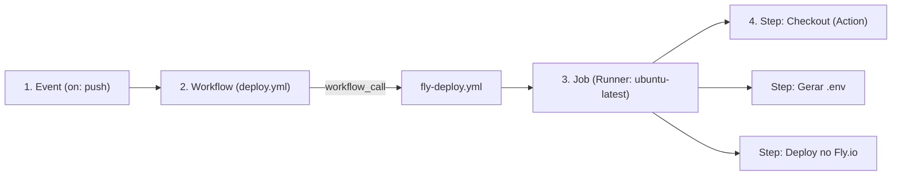

# Iniciando com GitHub Actions: CI/CD na Prática com Docker & Next.js


Eu gostaria de compartilhar de forma prática como estruturar um fluxo de build e deploy automatizado utilizando o **GitHub Actions** com **Docker**, **Next.js** e **Fly.io**. Muita gente acha que montar uma esteira de CI/CD é algo complexo demais para projetos menores, ou que basta copiar qualquer arquivo pronto sem entender o que está acontecendo por trás, mas organizar essa estrutura passo a passo é muito mais simples do que parece.

Para deixar esse guia 100% prático e direto ao ponto, criei este repositório público de exemplo com o fluxo completo já validado e rodando em produção, para que você possa consultar e usar como base nos seus próprios projetos:

- 🌐 **Aplicação rodando ao vivo no Fly.io:** https://front-example-actions-pedro.fly.dev/
- 🔗 **Repositório público:** https://github.com/PedroVOliveira/front-example-github-actions

---

## Sumário

1. [O que é o GitHub Actions e seus Fundamentos](#1-o-que-é-o-github-actions-e-seus-fundamentos)
2. [Pré-requisitos de Configuração (Token no Fly.io e `.env.example`)](#2-pré-requisitos-de-configuração-token-no-flyio-e-envexample)
3. [Configurando as Secrets no GitHub](#3-configurando-as-secrets-no-github)
4. [Configurando o `Dockerfile` e o `fly.toml`](#4-configurando-o-dockerfile-e-o-flytoml)
5. [Montando a pasta `.github/workflows` e Arquitetura via `workflow_call`](#5-montando-a-pasta-githubworkflows-e-arquitetura-via-workflow_call)
6. [Explicando a Action Passo a Passo e Linha a Linha](#6-explicando-a-action-passo-a-passo-e-linha-a-linha)
7. [Conclusão e Próximos Passos (Evoluções)](#7-conclusão-e-próximos-passos-evoluções)
8. [Referências e Documentações Oficiais](#8-referências-e-documentações-oficiais)

---

## 1. O que é o GitHub Actions e seus Fundamentos

Em vez de depender de ferramentas externas complexas logo no início do projeto, o **GitHub Actions** permite automatizar tarefas diretamente dentro do seu repositório no GitHub.

A lógica é simples: sempre que um evento acontece no repositório (como um código novo entrando na branch `main` ou alguém abrindo um *Pull Request*), o GitHub cria uma máquina virtual temporária, executa os passos que você definiu em um arquivo `.yml` e desliga a máquina ao terminar.

Para ler ou escrever qualquer pipeline sem precisar decorar sintaxe, você só precisa dominar **5 peças fundamentais**:



- **Workflow (Fluxo de trabalho)**: O processo automatizado completo descrito em um arquivo YAML.
- **Event (`on`)**: O gatilho que acorda o workflow (um `push` na `main`, um `pull_request`, um clique manual com `workflow_dispatch` ou a chamada de outro arquivo via `workflow_call`).
- **Runner (`runs-on`)**: O servidor virtual limpo (ex: `ubuntu-latest`) que o GitHub provisiona do zero para executar o trabalho.
- **Job**: O agrupamento de tarefas que rodam naquele Runner.
- **Step e Action**: Cada passo individual dentro do Job. Você pode rodar um comando puro de terminal (`run`) ou plugar uma **Action** pronta da comunidade (`uses`) para não reinventar a roda.

> 💡 **Quer consultar rapidamente cada termo e os anti-patterns do dia a dia?**
> Preparei um glossário direto ao ponto na raiz deste repositório. **[Acesse aqui o nosso GLOSSARY.md](./GLOSSARY.md)** sempre que quiser revisar a diferença exata entre cada componente da pipeline!

---

## 2. Pré-requisitos de Configuração (Token no Fly.io e `.env.example`)

Antes de criarmos os arquivos da nossa automação ou cadastrarmos variáveis no GitHub, precisamos preparar dois pré-requisitos básicos: **a credencial da nossa hospedagem no Fly.io** e **o mapa de variáveis da nossa aplicação**.

### 2.1. Criando sua conta e gerando o Token no Fly.io

Escolhi o **Fly.io** para este guia porque ele executa containers Docker reais (perfeito para o modo Server-Side do Next.js) e conversa diretamente com o GitHub Actions via linha de comando.

Para gerar a chave que permitirá ao GitHub Actions fazer o deploy por você:

1. Crie uma conta gratuita em **fly.io** e acesse o seu Dashboard (se aparecer a tela inicial perguntando por onde começar, clique em *Skip to my dashboard* ou *Machines*).
2. No menu lateral esquerdo, clique em **Tokens** (ou acesse *Account > Access Tokens*).
3. Clique em **Create token**, dê um nome (ex: `github-actions-deploy`) e copie o valor gerado. Guarde esse token — vamos usá-lo no próximo tópico!

### 2.2. Mapeando as variáveis no `.env.example`

Regra de ouro em engenharia de software: **arquivos `.env` reais nunca sobem para o Git**.

Para que qualquer pessoa que clonar o projeto saiba exatamente quais variáveis existem (e quais precisaremos cadastrar no GitHub Actions), mantemos na raiz o arquivo [`.env.example`](./.env.example):

```ini
APP_ENV=production
API_URL=https://api.exemplo.com.br/v1
```

> **Detalhe de bastidor no `.gitignore`:** Por padrão, projetos Next.js trazem a regra `.env*` no `.gitignore`, o que bloquearia também o seu `.env.example`! Por isso, adicionamos a exceção `!.env.example` no nosso [`.gitignore`](./.gitignore) para garantir que o arquivo de exemplo seja versionado.

---

## 3. Configurando as Secrets no GitHub

Agora que você já tem o token do Fly.io em mãos e sabe quais variáveis a aplicação consome pelo `.env.example`, onde guardamos esses valores com segurança?

No GitHub, utilizamos as **GitHub Secrets**. Tudo o que você cadastra lá é criptografado e injetado apenas em memória durante a execução da pipeline (se algum comando tentar imprimir o valor nos logs, o GitHub mascara automaticamente com `***`).

Siga este passo a passo no seu repositório do GitHub:

1. Clique na aba **Settings** (Configurações) no topo do repositório.
2. No menu lateral esquerdo, expanda **Secrets and variables** e clique em **Actions**.
3. Clique no botão verde **New repository secret** e cadastre estas **3 Secrets**:

| Nome da Secret (`Name`) | Valor (`Secret`) | Origem / Função |
| :--- | :--- | :--- |
| `APP_ENV` | `production` | Mapeada no nosso `.env.example` |
| `API_URL` | `https://api.exemplo.com.br/v1` | Mapeada no nosso `.env.example` |
| `FLY_API_TOKEN` | `fo1_...` *(seu token)* | Gerado no painel do Fly.io no Passo 2.1 |

---

## 4. Configurando o `Dockerfile` e o `fly.toml`

### 4.1. O `Dockerfile` em 3 estágios (Multi-stage Build)

Uma armadilha comum ao usar Docker no Front-end é colocar `ARG` e `ENV` com chaves secretas dentro do `Dockerfile`. Isso é um anti-pattern de segurança porque tudo o que é passado via `ARG` fica gravado no histórico de camadas da imagem (`docker history`).

Nosso [`Dockerfile`](./Dockerfile) (utilizando o modo `output: "standalone"` configurado no [`next.config.ts`](./next.config.ts)) não tem nenhuma variável sensível chumbada nele:

```dockerfile
# Stage 1: Install dependencies
FROM node:24-alpine AS deps

RUN corepack enable && corepack prepare pnpm@10.33.2 --activate

WORKDIR /app

COPY package.json pnpm-lock.yaml ./

RUN pnpm install --frozen-lockfile

# Stage 2: Build the application
FROM node:24-alpine AS build

RUN corepack enable && corepack prepare pnpm@10.33.2 --activate

WORKDIR /app

COPY --from=deps /app/node_modules ./node_modules
COPY . .

RUN pnpm run build

# Stage 3: Production image
FROM node:24-alpine AS production

RUN apk add --no-cache curl

WORKDIR /app

COPY --from=build /app/public ./public
COPY --from=build /app/.next/standalone ./
COPY --from=build /app/.next/static ./.next/static

EXPOSE 3000

ENV PORT=3000
ENV HOSTNAME="0.0.0.0"

CMD ["node", "server.js"]
```

Veja o motivo de cada bloco:

- **`FROM node:24-alpine` + Corepack com `pnpm@10.33.2` fixo**: Garante determinismo total. O container usa a mesma versão do Node 24 LTS definida no nosso [`.nvmrc`](./.nvmrc) e a mesma versão do `pnpm` do `package.json`.
- **`COPY package.json pnpm-lock.yaml ./` antes do `COPY . .`**: O Docker trabalha com cache em camadas. Copiando apenas os manifestos primeiro, se você alterar um componente React sem instalar pacotes novos, o Docker reaproveita o cache da instalação!
- **`pnpm install --frozen-lockfile`**: Trava de segurança para CI. Se alguém alterar o `package.json` e esquecer de atualizar o `pnpm-lock.yaml`, o build falha imediatamente em vez de instalar versões diferentes em produção.
- **Stage 3 (`AS production`) isolado**: Começa uma imagem Alpine do zero e copia apenas `public`, `.next/standalone` e `.next/static`. Todo o peso de compilação dos estágios 1 e 2 fica para trás.
- **`ENV HOSTNAME="0.0.0.0"`**: Sem essa linha, o servidor Node dentro do container pode escutar apenas em `127.0.0.1` (loopback interno), fazendo com que o proxy do Fly.io não consiga alcançar a sua aplicação!

### 4.2. Configurando o [`fly.toml`](./fly.toml)

Na raiz do projeto, o arquivo [`fly.toml`](./fly.toml) conecta o nosso `Dockerfile` à infraestrutura do Fly.io:

```toml
app = 'front-example-actions-pedro'
primary_region = 'gru'

[build]
  dockerfile = 'Dockerfile'

[http_service]
  internal_port = 3000
  force_https = true
  auto_stop_machines = 'stop'
  auto_start_machines = true
  min_machines_running = 0
  processes = ['app']

[[vm]]
  memory = '512mb'
  cpu_kind = 'shared'
  cpus = 1
```

- **`app = 'front-example-actions-pedro'`**: Identificador único da aplicação no Fly.io. *(Nota: ao testar pela primeira vez com o nome do repositório `front-example-github-actions`, o filtro anti-phishing do Fly.io bloqueou a criação porque proíbe a palavra `github` em subdomínios `*.fly.dev`! Se você fizer um fork para testar, troque para um nome único seu, como `front-example-actions-seunome`).*
- **`primary_region = 'gru'`**: Sobe o container em **São Paulo (Guarulhos)** para termos baixa latência no Brasil.
- **`[build] dockerfile = 'Dockerfile'`**: Instrui o Fly.io a construir a máquina usando o nosso `Dockerfile`.
- **`internal_port = 3000` e `auto_stop_machines = 'stop'`**: Aponta para a porta `3000` do container e configura a máquina para hibernar quando estiver sem acessos (custo zero em ociosidade) e ligar automaticamente em menos de 1 segundo quando alguém abrir o link.

---

## 5. Montando a pasta `.github/workflows` e Arquitetura via `workflow_call`

Chegou a hora de montar a estrutura onde o GitHub Actions vai morar.

Primeiro cuidado obrigatório: o diretório na raiz do projeto **precisa** se chamar exatamente **`.github/workflows/`** (no plural). Criar `.workflow` ou `.github/workflow` é o erro número 1 de quem está começando, pois o GitHub simplesmente ignora qualquer pasta com nome diferente.

Em vez de jogarmos tudo em um único arquivo YAML monolítico, estruturamos nossa pasta em **2 arquivos separados**:

```text
front-example-github-actions/
├── .github/
│   └── workflows/
│       ├── deploy.yml       <-- 1. Caller (Define QUANDO rodar e QUAIS dados passar)
│       └── fly-deploy.yml   <-- 2. Reusable Workflow (Define COMO fazer o build e deploy)
├── Dockerfile
├── fly.toml
├── .env.example
└── package.json
```

### Por que separar com `workflow_call`?

Usando o gatilho **`workflow_call`**, nós separamos responsabilidades:
- **O arquivo `deploy.yml` (Caller)**: Fica no repositório da aplicação e só define o gatilho (*"rode quando houver push na `main` usando este nome de app e estas secrets"*).
- **O arquivo `fly-deploy.yml` (Reusable)**: Isola toda a mecânica de infraestrutura. Aqui no nosso repositório de exemplo deixamos ele na mesma pasta para você conseguir estudar e clonar tudo junto, mas em um cenário real com vários projetos basta movê-lo para um **repositório central de workflows** para reutilizá-lo sem repetir código!

---

## 6. Explicando a Action Passo a Passo e Linha a Linha

Vamos abrir os dois arquivos e entender exatamente o que acontece em cada bloco.

### 6.1. O Orquestrador: [`.github/workflows/deploy.yml`](./.github/workflows/deploy.yml)

```yaml
name: Deploy (Production)

on:
  push:
    branches: [main]
  workflow_dispatch:

jobs:
  deploy:
    name: Deploy (production)
    uses: ./.github/workflows/fly-deploy.yml
    with:
      app_name: front-example-actions-pedro
    secrets:
      FLY_API_TOKEN: ${{ secrets.FLY_API_TOKEN }}
      APP_ENV: ${{ secrets.APP_ENV }}
      API_URL: ${{ secrets.API_URL }}
```

- **`on.push.branches: [main]`**: Automatiza o gatilho — qualquer commit ou merge na branch `main` inicia o deploy.
- **`on.workflow_dispatch`**: Habilita um botão manual **"Run workflow"** na aba Actions do GitHub.
- **`uses: ./.github/workflows/fly-deploy.yml`**: Conecta este job ao nosso arquivo reutilizável.
- **`with` e `secrets`**: Passa o parâmetro `app_name` e encaminha com segurança as 3 Secrets que cadastramos no Passo 3.

---

### 6.2. O Motor de Execução: [`.github/workflows/fly-deploy.yml`](./.github/workflows/fly-deploy.yml)

```yaml
name: Reusable — Fly.io Deploy

on:
  workflow_call:
    inputs:
      app_name:
        description: "Nome da aplicação no Fly.io"
        required: true
        type: string
    secrets:
      FLY_API_TOKEN:
        required: true
      APP_ENV:
        required: true
      API_URL:
        required: true

jobs:
  deploy:
    name: Build & Deploy on Fly.io
    runs-on: ubuntu-latest

    steps:
      - name: Checkout do código-fonte
        uses: actions/checkout@v4

      - name: Criar arquivo .env a partir das Secrets
        run: |
          echo "APP_ENV=${{ secrets.APP_ENV }}" >> .env
          echo "API_URL=${{ secrets.API_URL }}" >> .env

      - name: Configurar Flyctl CLI
        uses: superfly/flyctl-actions/setup-flyctl@master

      - name: Deploy do container no Fly.io
        run: |
          flyctl apps create "${{ inputs.app_name }}" || true
          flyctl deploy \
            --remote-only \
            --env APP_ENV="${{ secrets.APP_ENV }}" \
            --env API_URL="${{ secrets.API_URL }}"
        env:
          FLY_API_TOKEN: ${{ secrets.FLY_API_TOKEN }}
```

Veja como cada etapa trabalha em conjunto:

1. **Contrato de entrada (`on: workflow_call`)**: Exige que quem chamou este workflow informe obrigatoriamente o `app_name` e as 3 `secrets`.
2. **Ambiente limpo (`runs-on: ubuntu-latest` + `actions/checkout@v4`)**: Como a máquina virtual do GitHub nasce vazia, o primeiro passo usa a Action oficial `checkout@v4` para baixar o código do repositório.
3. **Injeção limpa do `.env` (`Criar arquivo .env a partir das Secrets`)**: Antes do build começar, gravamos o arquivo `.env` na máquina virtual com os valores das Secrets (`APP_ENV` e `API_URL`). Assim, quando o Stage 2 do nosso `Dockerfile` rodar o `pnpm run build`, o Next.js encontra as variáveis normalmente, sem sujar o `Dockerfile` com `ARG`.
4. **Instalação da CLI (`superfly/flyctl-actions/setup-flyctl@master`)**: Instala o comando `flyctl` no terminal do Runner.
5. **Criação segura do App (`flyctl apps create ... || true`)**: No primeiro deploy, cria o app no Fly.io. Nos próximos deploys (quando o app já existir), o `|| true` evita que o comando retorne erro e trave a pipeline.
6. **Build remoto e Deploy (`flyctl deploy --remote-only`)**: Constrói a nossa imagem Docker no *Remote Builder* do Fly.io, injeta as variáveis em runtime (`--env`) e coloca a nova versão no ar autenticada pelo `FLY_API_TOKEN`.

---

## 7. Conclusão e Próximos Passos (Evoluções)

Com tudo isso configurado e no lugar, a cada merge ou push na branch `main` você poderá acompanhar a sua Action rodando em tempo real diretamente na aba **Actions** do seu repositório no GitHub (você também pode visualizar o histórico dos nossos workflows rodando **[clicando aqui na aba Actions deste repositório](https://github.com/PedroVOliveira/front-example-github-actions/actions)**).

A partir dessa estrutura base que montamos, fica muito fácil evoluir o seu projeto conforme a necessidade:

- **Validação de Testes, Lint e PR Checks**: Você pode adicionar um job anterior ao deploy para rodar `pnpm run lint`, checagem de tipos (`tsc --noEmit`) e a sua camada de testes automatizados a cada *Pull Request* aberto — usando `needs` para garantir que o deploy nunca aconteça se algum teste quebrar.
- **Centralização em Repositório Único e Deploy em VPS Própria**: Quando você tiver mais projetos, pode extrair o workflow reutilizável para um repositório dedicado de workflows da sua conta/empresa. E caso o seu destino seja uma **VPS própria** (em vez do Fly.io), basta dividir em dois jobs separados (`build` compilando e salvando a imagem no `ghcr.io` + `deploy` entrando via SSH na VPS apenas para dar `docker pull`), evitando gastar a memória da sua VPS durante o build.

Espero que este guia e este repositório te ajudem a dar os primeiros passos e a estruturar pipelines completas nos seus próximos projetos!

---

## 8. Referências e Documentações Oficiais

Para quem quiser se aprofundar em cada tecnologia utilizada neste guia, reuni abaixo todas as referências oficiais:

- **GitHub Actions — Documentação Geral**: https://docs.github.com/pt/actions/about-github-actions/understanding-github-actions
- **GitHub Actions — Sintaxe de Workflows YAML**: https://docs.github.com/pt/actions/writing-workflows/workflow-syntax-for-github-actions
- **GitHub Actions — Gerenciamento Seguro de Secrets**: https://docs.github.com/pt/actions/security-for-github-actions/security-guides/using-secrets-in-github-actions
- **GitHub Actions — Workflows Reutilizáveis (`workflow_call`)**: https://docs.github.com/pt/actions/sharing-automations/reusing-workflows
- **Next.js — Modo `output: "standalone"` para Docker**: https://nextjs.org/docs/app/api-reference/config/next-config-js/output
- **Next.js — Exemplo Oficial `with-docker`**: https://github.com/vercel/next.js/tree/canary/examples/with-docker
- **Docker — Multi-stage Builds**: https://docs.docker.com/build/building/multi-stage/
- **pnpm — Boas práticas com Docker e Corepack**: https://pnpm.io/docker
- **Fly.io — Deploy Contínuo com GitHub Actions**: https://fly.io/docs/app-guides/continuous-deployment-with-github-actions/
- **Fly.io — Referência de Configuração do `fly.toml`**: https://fly.io/docs/reference/configuration/
- **Glossário do Repositório (`GLOSSARY.md`)**: [./GLOSSARY.md](./GLOSSARY.md)
